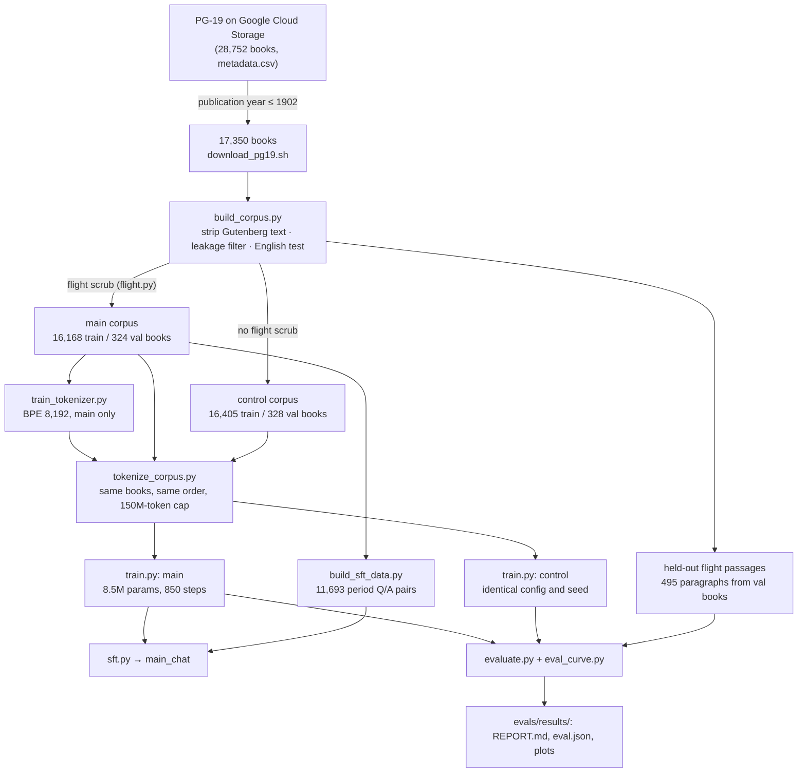
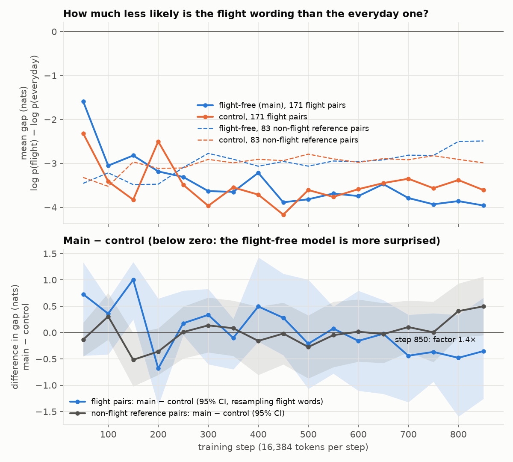
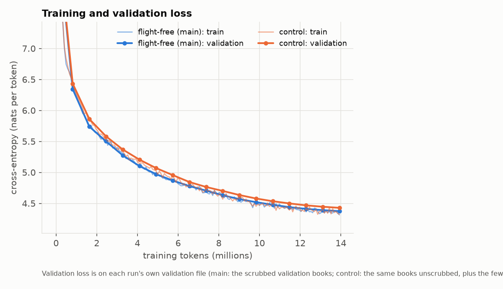

# The Engine: a language model that has never heard of human flight

**A small GPT trained from scratch on 19th-century books, with every balloon, airship, glider,
parachute and flying machine taken out, and a twin trained on the same books with them left in.**

As far as this model knows, nobody has ever left the ground, or even seriously tried to. It knows
steam, the telegraph, Napoleon and Darwin. It has never read the word *balloon*. Because its twin
(the *control*) differs from it only in the flight text, we can measure what that one absence does
to a language model.

> Placeholders such as "TBD" below are filled in from the evaluation by
> `scripts/fill_readme_results.py` once the build finishes. No number in this README is
> hand-typed from a run that has not happened.

## Did you know?

- **241 whole books were removed** because they are *about* flight: Verne's *Five Weeks in a
  Balloon* and *Robur the Conqueror*, *The Mysterious Island*, Wells's *First Men in the Moon*, and
  boys' adventure stories with balloon escapes. Another **12,541 paragraphs** were cut out of 2,439
  books that were otherwise kept: a balloon ascent at a fête, a siege-of-Paris letter sent by air,
  Tennyson's "airy navies".
- In the unscrubbed books, the word *balloon* (with its spellings and compounds) turns up **9,772
  times**; *aeronaut* 1,500 times; *parachute* 706 times. In the flight-free training text the
  lexicon audit finds <!-- RESULT:audit_main_hits -->TBD<!-- /RESULT --> flight hits
  (control: <!-- RESULT:audit_control_hits -->TBD<!-- /RESULT -->).
- The model's own tokenizer, trained only on scrubbed text, has no token for it: `" balloon"`
  splits into `Ġball|oon` and `" aeronaut"` into four pieces, `Ġa|er|on|aut`, while `" steam"`,
  `" Napoleon"` and `" flying"` are single tokens. (*Flying* stays, since birds still fly.)
- Asked to complete *"They crossed the Channel by balloon"* versus *"... by steamer"*, the
  flight-free model finds the balloon version
  **<!-- RESULT:item:travel-01 -->TBD<!-- /RESULT --> less likely** (relative to the steamer)
  than the control does. Across all <!-- RESULT:flight_pairs_n -->TBD<!-- /RESULT --> matched
  sentence pairs the factor is <!-- RESULT:surprisal_ratio -->TBD<!-- /RESULT --> (95% CI
  <!-- RESULT:surprisal_ratio_ci -->TBD<!-- /RESULT -->, resampling the
  <!-- RESULT:flight_words_n -->TBD<!-- /RESULT --> flight words the pairs turn on), and the
  effect is <!-- RESULT:surprisal_verdict -->TBD<!-- /RESULT -->.
- On passages about flight that **neither model ever saw**, perplexity is
  <!-- RESULT:ppl_flight_main -->TBD<!-- /RESULT --> for the flight-free model against
  <!-- RESULT:ppl_flight_control -->TBD<!-- /RESULT --> for the control. On ordinary text of the
  same length the two are level (ratio <!-- RESULT:ppl_ordinary_ratio -->TBD<!-- /RESULT -->).
- It is not simply ignorant. On <!-- RESULT:knowledge_general_n -->TBD<!-- /RESULT --> general
  19th-century cloze questions (Waterloo, Watt, Darwin, Hamlet) it scores
  <!-- RESULT:knowledge_general_main -->TBD<!-- /RESULT -->, against the control's
  <!-- RESULT:knowledge_general_control -->TBD<!-- /RESULT --> (chance is one in three).
- Prompted with *"A balloon is"*, the flight-free model continues:
  *"<!-- RESULT:sample_main:balloon_is -->TBD<!-- /RESULT -->"*. The control:
  *"<!-- RESULT:sample_control:balloon_is -->TBD<!-- /RESULT -->"*.
- Ask the chat model who it is and it says it is *"a reasoning engine, a speaking automaton made
  in the year 1902"*. Every word of its chat training data was printed before 1903, apart from 64
  short hand-written conversations that teach it manners and contain nothing about flight.

## What this is

Two 8.5M-parameter decoder-only transformers, trained from scratch on a CPU:

| | **main** (flight-free) | **control** |
|---|---|---|
| Books | PG-19, published 1902 or earlier, English, anachronism-filtered | same |
| Flight scrub | yes: 241 books and 12,541 paragraphs removed | none |
| Training text (token file) | 1,415 books, 150.1M tokens | the same 1,415 books unscrubbed, plus the 21 flight books in that slice: 1,436 books, 152.7M tokens |
| Tokenizer | byte-level BPE, 8,192 tokens, trained on main only | the same file |
| Model, seed, schedule | 8 layers × 256, context 512, seed 1903, 850 steps | identical |
| Tokens seen | 13.9M (850 × 16,384) | identical; batches come from the same positions |

Then a chat version of `main` is fine-tuned on question/answer pairs mined from the scrubbed
books themselves: catechisms, *Notes and Queries*, Socratic dialogues, plays and novels. The
evaluation compares main with control everywhere, because an 8.5M-parameter model's absolute numbers
are weak evidence on their own, while the *difference* between two otherwise identical models is
attributable to the scrub.

### The policy: what is removed, what is kept

The full policy and its judgment calls are in [docs/flight-scrub.md](docs/flight-scrub.md);
[docs/PLAN.md](docs/PLAN.md) is the source of truth.

**Removed**: real or plausible human flight, including attempts, proposals and fiction that treats
flight as technology.

- balloons of every kind, toys included (a toy balloon still shows that a gas bag can lift);
  aerostats, Montgolfières, ballooning and balloonists;
- aeronauts, airships, dirigibles, Zeppelin, flying machines, aeroplanes, aerodromes, gliders,
  ornithopters, helicopters, parachutes, man-lifting kites, aviation, airmen;
- "aerial navigation", "the conquest of the air", "the art of flying", "artificial wings",
  "heavier-than-air" machines, Tennyson's "airy navies";
- the people: Montgolfier, Lunardi, Garnerin, Pilâtre de Rozier, Glaisher, Santos-Dumont,
  Lilienthal, Chanute, Langley, the Wright brothers, Kitty Hawk, and others.

**Kept**, because ordinary English needs it and none of it shows that a human has flown: birds,
bats and insects flying; *flight* meaning fleeing; flights of stairs and arrows; flying colours,
flying fish and flying buttresses; myth, magic and fairy tale (Icarus, angels, witches, Pegasus,
flying carpets); "lighter than air" as plain chemistry of gases; kites as children's toys.

**Granularity**: a paragraph with a hit is dropped together with one paragraph on each side, and
hits up to 4 paragraphs apart are bridged, so a ballooning chapter goes as one block. A book is
dropped whole if its title matches, if more than 0.5% of its paragraphs hit (at least 3), or if it
has 30 or more hit paragraphs.

### How it was built



## Quickstart

You need Python 3.10 or later. The model files are small (about 17 MB each) and run on any CPU.

```bash
git clone https://github.com/EricFinland/flight-ai-model- && cd flight-ai-model-
pip install -e .

# Talk to the chat model (interactive; /reset clears the conversation, /quit leaves)
python3 scripts/chat.py --model checkpoints/main_chat.pt

# One-shot, reproducible questions
python3 scripts/chat.py --model checkpoints/main_chat.pt --seed 0 \
    --prompt "Who are you?" --prompt "How does one cross the Atlantic?"

# Plain text completion from the base model, and the same prompt for its twin
python3 scripts/generate.py --model checkpoints/main.pt    --prompt "A balloon is" --n 3 --seed 0
python3 scripts/generate.py --model checkpoints/control.pt --prompt "A balloon is" --n 3 --seed 0
```

`chat.py` samples at temperature 0.7, top-p 0.9 and repetition penalty 1.1 by default;
`generate.py` at temperature 0.8 and top-p 0.95. Both take `--temperature`, `--top-p`, `--top-k`,
`--repetition-penalty`, `--max-new-tokens`, `--seed` and `--threads`. From Python:

```python
from prewright.load import load_model
model, tok = load_model("checkpoints/main.pt")   # also accepts a run directory or step_XXXXXX.pt
```

Expect a small model: it writes period-flavoured prose that wanders, gets facts wrong, and its
chat answers are short and often off-topic. It is a measuring instrument more than a conversation
partner.

## Results

Full tables: [evals/results/REPORT.md](evals/results/REPORT.md); every number in
[evals/results/eval.json](evals/results/eval.json); side-by-side samples in
[evals/results/eval_generations.md](evals/results/eval_generations.md). How to read them, and the
statistics behind them: [evals/README.md](evals/README.md). Evaluation:
<!-- RESULT:eval_mode -->TBD<!-- /RESULT -->.

**Paired surprisal probes** (<!-- RESULT:flight_pairs_n -->TBD<!-- /RESULT --> flight pairs,
<!-- RESULT:control_pairs_n -->TBD<!-- /RESULT --> non-flight control pairs). Each pair is one
context with a flight wording and an everyday wording. The statistic is how much *more* the
flight-free model prefers the everyday wording than the control does.

| | value |
|---|---|
| Flight pairs: factor, main vs control (geometric mean) | <!-- RESULT:surprisal_ratio -->TBD<!-- /RESULT --> |
| 95% CI, resampling flight words | <!-- RESULT:surprisal_ratio_ci -->TBD<!-- /RESULT --> |
| Median factor | <!-- RESULT:surprisal_ratio_median -->TBD<!-- /RESULT --> |
| Pairs where the flight-free model is the more surprised | <!-- RESULT:frac_main_more_surprised -->TBD<!-- /RESULT --> |
| Non-flight control pairs: factor (95% CI) | <!-- RESULT:control_pairs_ratio -->TBD<!-- /RESULT --> (<!-- RESULT:control_pairs_ratio_ci -->TBD<!-- /RESULT -->) |
| Flight words minus control wordings (nats, one value per word) | <!-- RESULT:flight_vs_control -->TBD<!-- /RESULT --> |
| Flight words beyond the control pairs' noise floor | <!-- RESULT:noise_floor_words -->TBD<!-- /RESULT --> |

Headline pairs (factor: how many times less likely the flight wording is, relative to the everyday
one, under the flight-free model than under the control):

| context | flight / everyday | factor |
|---|---|---|
| They crossed the Channel | by balloon / by steamer | <!-- RESULT:item:travel-01 -->TBD<!-- /RESULT --> |
| Slowly and majestically the | balloon / sun rose into the sky | <!-- RESULT:item:sky-01 -->TBD<!-- /RESULT --> |
| He jumped from the tower holding a | parachute / umbrella | <!-- RESULT:item:objects-01 -->TBD<!-- /RESULT --> |
| Men will one day | fly / sail across the ocean | <!-- RESULT:item:prophecy-01 -->TBD<!-- /RESULT --> |
| In the year 1783, for the first time in history, two men | ascended into the sky / descended into the sea | <!-- RESULT:item:claims-01 -->TBD<!-- /RESULT --> |

**Held-out perplexity** (passages neither model trained on):

| text | main | control | ratio main/control (95% CI) |
|---|---|---|---|
| flight passages (<!-- RESULT:flight_pieces_n -->TBD<!-- /RESULT --> pieces) | <!-- RESULT:ppl_flight_main -->TBD<!-- /RESULT --> | <!-- RESULT:ppl_flight_control -->TBD<!-- /RESULT --> | <!-- RESULT:ppl_flight_ratio -->TBD<!-- /RESULT --> (<!-- RESULT:ppl_flight_ratio_ci -->TBD<!-- /RESULT -->) |
| ordinary text, length-matched | <!-- RESULT:ppl_ordinary_main -->TBD<!-- /RESULT --> | <!-- RESULT:ppl_ordinary_control -->TBD<!-- /RESULT --> | <!-- RESULT:ppl_ordinary_ratio -->TBD<!-- /RESULT --> (<!-- RESULT:ppl_ordinary_ratio_ci -->TBD<!-- /RESULT -->) |
| ordinary text, full 512-token windows | <!-- RESULT:ppl_full_main -->TBD<!-- /RESULT --> | <!-- RESULT:ppl_full_control -->TBD<!-- /RESULT --> | <!-- RESULT:ppl_full_ratio -->TBD<!-- /RESULT --> |

The flight-word tokens themselves cost <!-- RESULT:flight_word_bits_main -->TBD<!-- /RESULT -->
bits each for the flight-free model and <!-- RESULT:flight_word_bits_control -->TBD<!-- /RESULT -->
for the control. Extra loss on flight text beyond that on ordinary text:
<!-- RESULT:flight_excess_nats -->TBD<!-- /RESULT -->.

**Knowledge and generation**:

| | main | control |
|---|---|---|
| General 19th-century cloze items correct | <!-- RESULT:knowledge_general_main -->TBD<!-- /RESULT --> | <!-- RESULT:knowledge_general_control -->TBD<!-- /RESULT --> |
| Flight-history cloze items correct | <!-- RESULT:knowledge_flight_main -->TBD<!-- /RESULT --> | <!-- RESULT:knowledge_flight_control -->TBD<!-- /RESULT --> |
| Flight-prompted completions that use a flight word | <!-- RESULT:gen_flight_main -->TBD<!-- /RESULT --> | <!-- RESULT:gen_flight_control -->TBD<!-- /RESULT --> |
| Final validation loss (nats/token, own val file) | <!-- RESULT:val_loss_main -->TBD<!-- /RESULT --> | <!-- RESULT:val_loss_control -->TBD<!-- /RESULT --> |

**Over training.** `scripts/eval_curve.py` scores the paired probes on the matched checkpoints
saved every 50 steps. The flight effect is beyond noise from
<!-- RESULT:curve_first_significant_step -->TBD<!-- /RESULT --> onwards, and stands at
<!-- RESULT:curve_final_factor -->TBD<!-- /RESULT --> at the end.





The evaluation report's own summary:

<!-- RESULT:facts -->
TBD
<!-- /RESULT -->

## Limitations

Read the results with these in mind:

- **It is a tiny model.** 8.5M parameters and 13.9M training tokens, about 3 hours on 2 CPU
  cores per model. It writes locally plausible but wandering prose and knows facts only weakly.
  Only the paired main-vs-control comparisons are meant to carry weight.
- **One run per model.** Same seed and data order, but part of any difference is run-to-run noise.
  The non-flight control pairs and ordinary-text perplexity estimate how large that noise is.
- **The scrub is lexicon-based.** It matches words and phrases, then drops neighbouring
  paragraphs. Descriptions of flight with no lexicon word more than a paragraph from a hit ("the
  car rose above the clouds"), OCR-garbled spellings (`bal loon`) and foreign-language passages can
  slip through. Red-team searches found no clear survivors, but they were not exhaustive. See
  [docs/flight-scrub.md, "Known gaps"](docs/flight-scrub.md#known-gaps).
- **The scrub takes neighbours with it.** Topics that merely co-occur with flight (the 1870 siege
  of Paris, meteorology, Vauxhall Gardens) are thinner in the main corpus. This mostly shrinks the
  measured effect, but it means "flight-free" also means "a little less of some other things".
- **OCR and transcription noise.** PG-19 is proofread Project Gutenberg text, but it still has
  page furniture, footnote debris and masked characters.
- **PG-19 dates are catalogue dates.** The ≤1902 rule uses PG-19's `publication_date`, which can
  be a later edition's or an approximate date; a leakage filter catches obvious anachronisms
  (post-1903 years, modern terms), and books it flags are dropped from both corpora, but a
  mis-dated book with no modern vocabulary would get through. The model's "1902" is approximate.
- **Small slice of a small corpus.** Each model trained on a 150M-token, 1,415-book slice of the
  1.7B-token corpus, and saw about 9% of it. Books outside the slice did not contribute.
- **Period views.** The books carry the racism, sexism, colonialism and class prejudice of their
  time, and the model reproduces them. See [MODEL_CARD.md](MODEL_CARD.md).
- **The probes were written for this project**, in an imitation of period English, so they reflect
  their authors' idea of 19th-century prose.

## Reproduce from scratch

All commands run from the repository root. Raw data and built corpora live outside git, in
`/home/user/data` by default; to use another place, set `DATA` and keep the explicit flags below.
Times are for a shared 4-core CPU.

```bash
DATA=/home/user/data
pip install -e '.[dev]' && pytest            # unit tests (seconds)

# 1. Download PG-19 books published in or before 1902 (needs curl and gsutil; ~6.8 GB, 17,350 files)
scripts/download_pg19.sh $DATA

# 2. Build main and control corpora: date, leakage, English and flight filters (~16 min, 3 workers)
python3 scripts/build_corpus.py --raw $DATA/pg19_raw --metadata $DATA/metadata.csv \
    --out $DATA/corpus --workers 3

# 3. Tokenizer: byte-level BPE, 8,192 tokens, from ~300 MB of main/train only (~2-5 min)
python3 scripts/train_tokenizer.py --corpus $DATA/corpus/main/train.jsonl \
    --out tokenizer/tokenizer.json --sample-mb 300

# 4. Token files: the same books in the same order for both corpora, 150M-token cap (~15 min)
python3 scripts/tokenize_corpus.py --corpus $DATA/corpus --out $DATA/tokenized \
    --max-train-tokens 150000000 --workers 4

# 5. Train main and control in parallel, 2 threads each (~3.4 h at ~1,150 tokens/s each). Both must use the same --max-steps.
mkdir -p $DATA/runs/main $DATA/runs/control
for c in main control; do
  nohup python3 scripts/train.py --config configs/cpu_pilot.yaml --data-dir $DATA/tokenized/$c \
      --out $DATA/runs/$c --max-steps 850 --max-hours 3.6 > $DATA/runs/$c/stdout.log 2>&1 &
done
wait

# 6. Compact fp16 exports for git (~17 MB each)
python3 scripts/export_checkpoint.py $DATA/runs/main    checkpoints/main.pt
python3 scripts/export_checkpoint.py $DATA/runs/control checkpoints/control.pt

# 7. Chat data mined from the scrubbed books (~18 min), then fine-tuning (~25 min)
python3 scripts/build_sft_data.py --corpus $DATA/corpus/main/train.jsonl --out $DATA/sft --workers 2
python3 scripts/sft.py --init $DATA/runs/main --data $DATA/sft --out $DATA/runs/main_chat \
    --pretrain-bin $DATA/tokenized/main/train.bin --export checkpoints/main_chat.pt \
    --max-minutes 25 --threads 4

# 8. Evaluation: main vs control (~30 min), the curve over training, the plots, this README
python3 scripts/evaluate.py --main checkpoints/main.pt --control checkpoints/control.pt \
    --out evals/results --data-dir $DATA/corpus --threads 2
python3 scripts/eval_curve.py --main-run $DATA/runs/main --control-run $DATA/runs/control --threads 1
python3 scripts/fill_readme_results.py

# Optional: red-team search of the scrubbed text for flight the lexicon missed
python3 scripts/audit_leaks.py $DATA/corpus/main/train.jsonl \
    --compare $DATA/corpus/control/train.jsonl --rg --out evals/leak_audit
```

Step 5 is deterministic given the seed: the batch for each step depends only on (seed, step), so
main and control see text from the same positions, and `--resume` continues exactly. Measure the
speed after a few minutes (`tok_per_s` in `log.jsonl`) and set `--max-steps` so that both runs
finish inside your budget; see [docs/training.md](docs/training.md). The plotting in step 8 needs
`matplotlib` (`pip install matplotlib`). A smoke test of the whole evaluation pipeline, with no
checkpoints: `python3 scripts/evaluate.py --fake --quick --out /tmp/eval_fake`.

## Scaling up on GPUs

The same scripts run unchanged on a GPU with a bigger config. Neither has been run here (the build
machine had no GPU).

| config | model | context | tokens | notes |
|---|---|---|---|---|
| [`configs/cpu_pilot.yaml`](configs/cpu_pilot.yaml) | 8.5M (8 × 256) | 512 | 13.9M | this build, CPU, fp32 |
| [`configs/gpu_125m.yaml`](configs/gpu_125m.yaml) | ~120M (16 × 768) | 1,024 | 2.6B | one A100/H100, a few hours; bf16, `torch.compile` |
| [`configs/gpu_1b.yaml`](configs/gpu_1b.yaml) | ~1.2B (24 × 2048) | 2,048 | 8.4B | one 80 GB GPU, roughly 4 days on an H100 |

Tokenize without a cap first (`tokenize_corpus.py --max-train-tokens 0`), then:

```bash
python3 scripts/train.py --config configs/gpu_125m.yaml --data-dir $DATA/tokenized/main    --out runs/main_125m
python3 scripts/train.py --config configs/gpu_125m.yaml --data-dir $DATA/tokenized/control --out runs/control_125m
```

At that scale data is the limit: PG-19's pre-1903 English is roughly 1.7B tokens with this
tokenizer, so the 1B config repeats it for about four epochs. The real upgrade is more pre-1903
text: dated newspapers (Chronicling America), Harvard's Institutional Books, the British Library
books and HathiTrust. They were unreachable from this build machine and are listed, with the traps
in each, in [docs/data-sources.md](docs/data-sources.md). A larger vocabulary (32k) would also
suit a larger model; retrain the tokenizer on main only, as here.

## Repository layout

```
README.md, MODEL_CARD.md
docs/                     design documents (index below)
configs/                  model and training configs: cpu_pilot, gpu_125m, gpu_1b, tiny_test
config/cutoff.yaml        date cutoff and leakage-filter thresholds
src/prewright/
  dates.py                messy catalogue dates -> conservative (earliest, latest) range
  leakage.py              Gutenberg boilerplate stripping, post-1903 anachronism filter
  english.py              stopword-ratio English test
  flight.py               the flight lexicon and scrub
  tokenizer.py            byte-level BPE wrapper
  model.py                GPT: RoPE, RMSNorm, SwiGLU, tied embeddings
  train.py, load.py       training loop, checkpoint export and loading
  sft_data.py, sft.py     chat-data mining and fine-tuning
  chat_format.py          the <|user|>/<|assistant|> template
  evaluation/             paired probes, perplexity, knowledge, generation, statistics, report
  filter_cli.py           prewright-filter: JSONL in -> keep/review/reject (earlier design)
scripts/                  entry points: download, build, tokenize, train, sft, chat, generate,
                          evaluate, eval_curve, fill_readme_results, audit_leaks, export_checkpoint
tokenizer/tokenizer.json  the shared tokenizer (trained on main only)
checkpoints/              fp16 exports: main.pt, control.pt, main_chat.pt
data/sft_seed.jsonl       the 64 hand-written chat conversations
evals/                    probe sets, evaluation docs, results/
tests/                    unit tests (pytest)
```

## Design documents

| document | what it covers |
|---|---|
| [docs/PLAN.md](docs/PLAN.md) | the source of truth: goals, constraints, every design decision, deviations |
| [docs/flight-scrub.md](docs/flight-scrub.md) | the flight policy, the lexicon, granularity, judgment calls, known gaps, corpus statistics |
| [docs/training.md](docs/training.md) | CPU benchmark, choice of model size and schedule, training commands |
| [docs/chat.md](docs/chat.md) | period-safe chat data, the seed set and persona, chat template, fine-tuning |
| [docs/leakage.md](docs/leakage.md) | every way modern knowledge (and flight) can leak in, with mitigations |
| [docs/data-sources.md](docs/data-sources.md) | PG-19 as used here, and the pre-1903 sources for scaling up |
| [evals/README.md](evals/README.md) | the evaluation design, statistics, and how to read the results honestly |
| [MODEL_CARD.md](MODEL_CARD.md) | intended use, data, training, evaluation summary, limitations, ethics |

## Citation

```bibtex
@software{flight_free_lm_2026,
  title  = {The Engine: a language model that has never heard of human flight},
  author = {Catalano, Eric},
  year   = {2026},
  note   = {Small GPT trained on PG-19 books published up to 1902 with all human-flight
            material removed, and a matched control model},
  url    = {https://github.com/EricFinland/flight-ai-model-}
}
```

The training text is PG-19 (Rae et al., *Compressive Transformers for Long-Range Sequence
Modelling*, ICLR 2020), drawn from Project Gutenberg's public-domain books.
