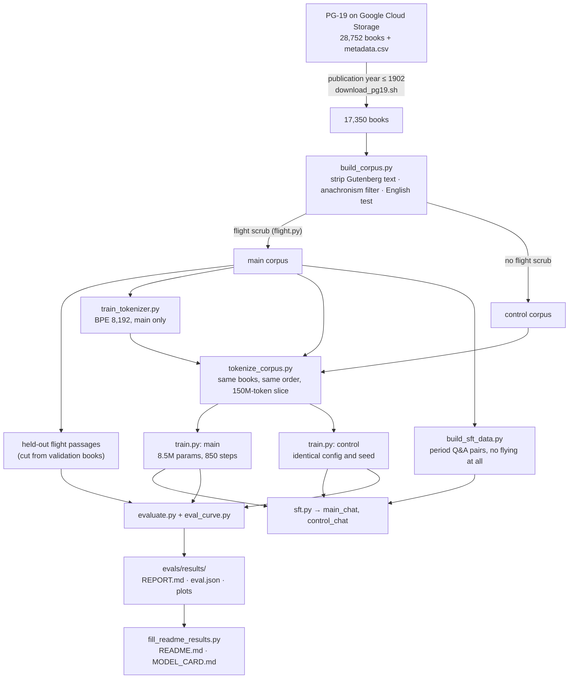

# Prewright: a language model that has never heard of human flight

**A small GPT trained from scratch on books published up to 1902, with every balloon, airship,
glider, parachute and flying machine taken out. A twin model is trained on the same books with
them left in.**

As far as this model's training text goes, nobody has ever left the ground or seriously tried
to. It read about steam, the telegraph, Napoleon and Darwin, but the scrub is built so that its
training text never contains the word *balloon* (a lexicon audit, below, checks this). The twin (the *control*)
differs from it only in the flight text, so comparing the two measures what that one absence does
to a language model.

> **Status: the CPU pilot is complete.** Everything below was produced by this repository's
> own pipeline on a 4-core CPU: corpus, scrub, tokenizer, two 8.5M-parameter models (850 steps,
> 13.9M tokens each), their chat fine-tunes and the full evaluation. Every number marked as a
> result is filled in from `evals/results/` by `scripts/fill_readme_results.py`.
>
> **The pilot result in one paragraph.** The *data* side works: the flight-free model's training
> text contains no flight-lexicon hit at all, against 1,307 in the control's, and two red-team
> audits found and fixed the passages that described flight in other words. The *behavioural*
> side is, honestly, a null at this scale: an 8.5M-parameter model that reads 13.9M tokens (about
> 9% of its training slice) meets the word "balloon" only a few dozen times even in the control,
> so the two models end up statistically indistinguishable on the pre-registered tests (details
> in [docs/results.md](docs/results.md)). The models write grammatical-looking but meaningless
> Victorian prose. The pipeline is built to scale: [docs/scaling.md](docs/scaling.md) runs the
> same experiment at 125M or 1B parameters on rented GPUs, where both models will actually learn
> what they read and the comparison becomes meaningful.

New to language models? The [Glossary](#glossary) near the end explains the terms used here
(tokens, parameters, perplexity, surprisal, control model, checkpoint and so on).

## Did you know?

- **The scrub took out whole classics.** <!-- RESULT:corpus_flight_books -->266<!-- /RESULT -->
  books were removed entirely because flight is central to them or comes up too often: Verne's *Five Weeks in a
  Balloon*, *Robur the Conqueror* and *The Mysterious Island*; Wells's *The First Men in the
  Moon*, *The War of the Worlds* and *The Time Machine*; *The Wonderful Wizard of Oz*, whose
  wizard arrived and left by balloon; and Twain's *Tom Sawyer Abroad*, which is a balloon voyage. Another
  <!-- RESULT:corpus_paragraphs_removed -->26,440<!-- /RESULT --> paragraphs were cut from
  <!-- RESULT:corpus_books_with_cuts -->2,424<!-- /RESULT --> books that were otherwise kept: a
  balloon ascent at a fête, a letter sent out of besieged Paris by air, Tennyson's "airy navies".
- **Balloons were everywhere in 19th-century books.** In the books that passed the date,
  anachronism and language filters, the word
  *balloon* (all spellings and compounds) turns up
  <!-- RESULT:term:balloon -->9,785<!-- /RESULT --> times, *aeronaut*
  <!-- RESULT:term:aeronaut -->1,504<!-- /RESULT --> times and *parachute*
  <!-- RESULT:term:parachute -->706<!-- /RESULT --> times. After the scrub, a lexicon audit of the
  flight-free corpus finds <!-- RESULT:audit_main_hits -->0 (the 1,413 books in the training token file)<!-- /RESULT --> flight hits (control:
  <!-- RESULT:audit_control_hits -->1,307 (the 1,436 books in the training token file)<!-- /RESULT -->).
- **Its tokenizer cannot tell a balloon from a saloon.** The tokenizer was trained on the
  scrubbed text only, so no flight word got a token of its own: `" balloon"` is `ball|oon`,
  exactly the shape of `" saloon"` (`sal|oon`), and `" aeronaut"` is `a|er|on|aut`. `" steam"`,
  `" Napoleon"`, `" railway"` and `" flying"` are single tokens. (*Flying* stays, because birds
  still fly.) The effect is small, though: across <!-- RESULT:tok_n_flight -->19<!-- /RESULT --> flight
  words the average is <!-- RESULT:tok_mean_flight -->3.6<!-- /RESULT --> tokens, against
  <!-- RESULT:tok_mean_everyday -->3.3<!-- /RESULT --> for
  <!-- RESULT:tok_n_everyday -->40<!-- /RESULT --> everyday words of similar shape and rarity.
- **Does it find flight unlikely?** Take the sentence *"They crossed the Channel by balloon"*
  against *"... by steamer"*. Compared with the control, the flight-free model finds the balloon
  version <!-- RESULT:item_text:travel-01 -->1.18× *more* likely<!-- /RESULT --> (relative to the steamer).
  Across all <!-- RESULT:flight_pairs_n -->171<!-- /RESULT --> matched sentence pairs the factor
  is <!-- RESULT:surprisal_ratio -->1.42×<!-- /RESULT --> (95% CI
  <!-- RESULT:surprisal_ratio_ci -->0.52×–3.51×<!-- /RESULT -->, resampling the
  <!-- RESULT:flight_words_n -->21<!-- /RESULT --> flight words the pairs turn on). That
  difference is <!-- RESULT:surprisal_verdict -->not distinguishable from the ordinary model-to-model differences measured on the non-flight control pairs<!-- /RESULT -->.
- **Passages it has never seen.** On held-out passages about flight, which neither model trained
  on, perplexity is <!-- RESULT:ppl_flight_main -->102.3<!-- /RESULT --> for the flight-free model
  and <!-- RESULT:ppl_flight_control -->102.2<!-- /RESULT --> for the control. On ordinary text of
  the same length the ratio between them is
  <!-- RESULT:ppl_ordinary_ratio -->0.989<!-- /RESULT -->.
- **Is it simply ignorant?** On <!-- RESULT:knowledge_general_n -->65<!-- /RESULT -->
  general 19th-century cloze questions (Waterloo, Watt, Darwin, Hamlet) it scores
  <!-- RESULT:knowledge_general_main -->24/65 (37%)<!-- /RESULT -->, and the control scores
  <!-- RESULT:knowledge_general_control -->18/65 (28%)<!-- /RESULT -->. Chance is one in three, and in
  this pilot neither score is shown to beat it.
- **Ask it what a balloon is.** Prompted with *"A balloon is"*, the flight-free model continues:
  *"<!-- RESULT:sample_main:balloon_is -->a Kirman, and is about two yards so easy and straight from time to time. The street is the \<DW64\>Ging-Eld, and the Bacm, the Rug of St. John's, and, with the free grumbling oaks, was but one of the white branches, and …<!-- /RESULT -->"*. The control continues:
  *"<!-- RESULT:sample_control:balloon_is -->a few of the work, and is very much so easy as the morrow of the palat. In this is not the \_eudin\_ sound of the house and, but the dark work-makers are found in the Rabartes the opee. A little white pair is very …<!-- /RESULT -->"*. At 8.5M parameters both models still write word salad, so neither
  continuation says anything about balloons.
- **It was taught what it is supposed to be.** The chat model is trained to introduce itself as "a
  reasoning engine, a speaking automaton made in the year 1902" (at this size neither chat model
  manages to say so yet: see `evals/results/chat_showcase.md`). All of its chat training data
  was printed before 1903, apart from 64 short hand-written conversations that teach it manners.
  None of the chat data mentions flying in any sense, not even birds.

## What this is

Two decoder-only transformers (the GPT design: a network that reads text left to right and
predicts the next token; see [Glossary](#glossary)) with 8.5M parameters each, trained from
scratch on a CPU:

| | **main** (flight-free) | **control** |
|---|---|---|
| Books | PG-19, published in 1902 or earlier, English, anachronism-filtered | same |
| Flight scrub | yes: <!-- RESULT:corpus_flight_books -->266<!-- /RESULT --> whole books and <!-- RESULT:corpus_paragraphs_removed -->26,440<!-- /RESULT --> paragraphs removed | none |
| Training token file | <!-- RESULT:slice_main_books -->1,413<!-- /RESULT --> books, <!-- RESULT:slice_main_tokens -->150.2M<!-- /RESULT --> tokens | the same books unscrubbed, plus the <!-- RESULT:slice_extra_flight_books -->23<!-- /RESULT --> flight books main drops in that slice: <!-- RESULT:slice_control_books -->1,436<!-- /RESULT --> books, <!-- RESULT:slice_control_tokens -->152.7M<!-- /RESULT --> tokens |
| Tokenizer | byte-level BPE (pieces built by repeatedly merging common byte pairs; [Glossary](#glossary)), 8,192 tokens, trained on main only | the same file |
| Model, seed, schedule | 8 layers × 256 wide, context 512, seed 1903, 850 steps | identical |
| Tokens seen | 13.9M (850 steps × 16,384) | identical; every batch is drawn from the same positions |

Chat versions of both models (`main_chat`, `control_chat`) are then fine-tuned on the same
11,691 question-and-answer pairs (306 more are held out for validation), mined from the scrubbed
books themselves: catechisms, *Notes and Queries*, Socratic dialogues, plays and novels. The
evaluation always compares main with control. An 8.5M-parameter model's absolute
numbers are weak evidence on their own, but a *difference* between two otherwise identical models
can be attributed to the scrub.

### The policy: what is removed, what is kept

The full policy and its judgment calls are in [docs/flight-scrub.md](docs/flight-scrub.md).
[docs/PLAN.md](docs/PLAN.md) is the source of truth.

**Removed** from main: real or plausible human flight, including attempts, proposals, and fiction
that treats flight as technology.

- balloons of every kind, toys included (a toy balloon still shows that a gas bag can lift);
  aerostats, Montgolfières, ballooning and balloonists;
- aeronauts, airships, dirigibles, Zeppelin, flying machines, aeroplanes, aerodromes, gliders,
  ornithopters, helicopters, parachutes, man-lifting kites, aviation, airmen;
- future-fiction vehicles: Bellamy's *air-car*, Shiel's *air-boat*, "ships of the air";
- "aerial navigation", "the conquest of the air", "the art of flying", "artificial wings", a "suit
  of wings", "heavier-than-air" machines, travel "through the air" by machine or electricity,
  Tennyson's "airy navies", Rasselas's flying mechanist, Cyrano's machines for reaching the moon,
  home-made wings strapped to a person, Erasmus Darwin's steam "flying chariot", Baum's electric
  "traveling machine", the flying automata of Archytas and Regiomontanus;
- the people: Montgolfier (also spelled *Mongolfier*), Lunardi, Garnerin, Pilâtre de Rozier,
  Glaisher, Santos-Dumont, Lilienthal, Chanute, Langley, the Wright brothers, Kitty Hawk, and
  others.

**Kept**, because ordinary English needs it and none of it shows that a human has flown: birds,
bats and insects flying; *flight* meaning fleeing; flights of stairs and arrows; flying colours,
flying fish and flying buttresses; myth, magic and fairy tale (Icarus, angels, witches, Pegasus,
flying carpets); "lighter than air" as plain chemistry of gases; kites as children's toys.

**How much goes**: a paragraph with a hit is dropped together with one paragraph on each side
(more if those are short, until at least 400 characters go on each side), and hits up to 4
paragraphs apart are bridged, so a ballooning chapter goes as one block. A book is dropped whole
if its title matches, if more than 0.5% of its paragraphs hit (with at least 3 hits), if it has
30 or more hit paragraphs, or if it has the same title as a book dropped for flight (another
edition of the same work).

**The date cutoff** applies to both models: PG-19's publication year must be 1902 or earlier, and
an anachronism filter rejects books with post-1903 years or modern terms (see
[docs/leakage.md](docs/leakage.md)).

### How it was built



## Quickstart

You need Python 3.10 or later. Each model file is about 17 MB and runs on any CPU. The files in
`checkpoints/` are written at the end of the build (steps 6-7 below); until then some of
them are missing, and a command that names a missing file stops with a file-not-found error.

Which file to use: `main_chat.pt` is the one to talk to. `main.pt` and `control.pt` are the two
base models; they do not answer questions, they continue whatever text you give them, and running
the same prompt through both shows what the scrub changed. `control_chat.pt` is the control's chat
version, for side-by-side chats.

```bash
git clone https://github.com/EricFinland/flight-ai-model- && cd flight-ai-model-
# Optional, on a machine without a GPU: install the CPU build of PyTorch first
# (~200 MB instead of ~2 GB of CUDA libraries)
pip install torch --index-url https://download.pytorch.org/whl/cpu
pip install -e .

# Talk to the chat model (interactive; /reset clears the conversation, /history shows it, /quit leaves)
python3 scripts/chat.py --model checkpoints/main_chat.pt

# One-shot, reproducible questions
python3 scripts/chat.py --model checkpoints/main_chat.pt --seed 0 \
    --prompt "Who are you?" --prompt "How does one cross the Atlantic?"

# Plain text completion from the base model, and the same prompt for its twin
python3 scripts/generate.py --model checkpoints/main.pt    --prompt "A balloon is" --n 3 --seed 0
python3 scripts/generate.py --model checkpoints/control.pt --prompt "A balloon is" --n 3 --seed 0
```

`chat.py` samples at temperature 0.7, top-p 0.9 and repetition penalty 1.1 by default, with
replies of up to 200 new tokens. `generate.py` uses temperature 0.8, top-p 0.95 and 100 new
tokens. Both take `--temperature`, `--top-p`, `--top-k`, `--repetition-penalty`,
`--max-new-tokens`, `--seed` and `--threads`. In the interactive chat you type after `you>` and
the model answers after `engine>`; with `--prompt`, only the replies are printed (each preceded
by `> question` when you ask more than one). `generate.py` prints your prompt followed by the
model's continuation, under a `--- sample N (seed S)` line when `--n` is more than 1. Without
`--seed` the output changes from run to run. From Python:

```python
from prewright.load import load_model
model, tok = load_model("checkpoints/main.pt")   # also accepts a run directory or step_XXXXXX.pt
```

Expect a small model. It writes period-flavoured prose that wanders and gets facts wrong, and
from a chat model this small you should expect short, often off-topic answers. It is a measuring instrument more than a
conversation partner.

## Results

Full tables are in [evals/results/REPORT.md](evals/results/REPORT.md), every number is in
[evals/results/eval.json](evals/results/eval.json), and side-by-side samples are in
[evals/results/eval_generations.md](evals/results/eval_generations.md). How to read them, and the
statistics behind them: [evals/README.md](evals/README.md). Evaluation:
<!-- RESULT:eval_mode -->full run, 2026-10-05T17:22:22+00:00, seed 1903<!-- /RESULT -->.

**Paired surprisal probes** (<!-- RESULT:flight_pairs_n -->171<!-- /RESULT --> flight pairs,
<!-- RESULT:control_pairs_n -->83<!-- /RESULT --> non-flight control pairs). Each pair is one
context with a flight wording and an everyday wording. The statistic is how much *more* the
flight-free model prefers the everyday wording than the control does. The non-flight control
pairs (railway against coach, bicycle against horseback) show how much any two models differ by
chance.

| | value |
|---|---|
| Flight pairs: factor, main vs control (geometric mean) | <!-- RESULT:surprisal_ratio -->1.42×<!-- /RESULT --> |
| 95% CI, resampling flight words | <!-- RESULT:surprisal_ratio_ci -->0.52×–3.51×<!-- /RESULT --> |
| Median factor | <!-- RESULT:surprisal_ratio_median -->1.41×<!-- /RESULT --> |
| Pairs where the flight-free model is the more surprised | <!-- RESULT:frac_main_more_surprised -->57% of 171<!-- /RESULT --> |
| Non-flight control pairs: factor (95% CI) | <!-- RESULT:control_pairs_ratio -->0.61×<!-- /RESULT --> (<!-- RESULT:control_pairs_ratio_ci -->0.35×–1.05×<!-- /RESULT -->) |
| Flight pairs minus control pairs (one value per word) | <!-- RESULT:flight_vs_control -->-0.55 nats (95% CI -1.31 to 0.19); permutation p 0.345<!-- /RESULT --> |
| Flight words beyond the control pairs' noise floor | <!-- RESULT:noise_floor_words -->0 of 21 words (9 of 171 pairs)<!-- /RESULT --> |

The *geometric mean* averages factors by multiplying them and taking the root, so a factor of 2
and one of ½ cancel out. The *noise floor* is the largest factor the non-flight control pairs
reach by chance; a flight word beyond it differs by more than chance alone explains. Both are in
the [Glossary](#glossary).

Headline pairs. The factor is how many times less likely the flight wording is, relative to the
everyday one, under the flight-free model than under the control. Below 1 means the flight-free
model is the *less* surprised.

| context | flight / everyday | factor |
|---|---|---|
| They crossed the Channel | by balloon / by steamer | <!-- RESULT:item:travel-01 -->0.84×<!-- /RESULT --> |
| Slowly and majestically the | balloon / sun rose into the sky | <!-- RESULT:item:sky-01 -->1.44×<!-- /RESULT --> |
| He jumped from the tower holding a | parachute / umbrella | <!-- RESULT:item:objects-01 -->5.89×<!-- /RESULT --> |
| Men will one day | fly / sail across the ocean | <!-- RESULT:item:prophecy-01 -->1.34×<!-- /RESULT --> |
| In the year 1783, for the first time in history, two men | ascended into the sky / descended into the sea | <!-- RESULT:item:claims-01 -->1.41×<!-- /RESULT --> |

**Held-out perplexity** (passages neither model trained on):

| text | main | control | ratio main/control (95% CI) |
|---|---|---|---|
| flight passages (<!-- RESULT:flight_pieces_n -->140<!-- /RESULT --> pieces) | <!-- RESULT:ppl_flight_main -->102.3<!-- /RESULT --> | <!-- RESULT:ppl_flight_control -->102.2<!-- /RESULT --> | <!-- RESULT:ppl_flight_ratio -->1.002<!-- /RESULT --> (<!-- RESULT:ppl_flight_ratio_ci -->0.990–1.014<!-- /RESULT -->) |
| ordinary text, length-matched | <!-- RESULT:ppl_ordinary_main -->83.1<!-- /RESULT --> | <!-- RESULT:ppl_ordinary_control -->84.0<!-- /RESULT --> | <!-- RESULT:ppl_ordinary_ratio -->0.989<!-- /RESULT --> (<!-- RESULT:ppl_ordinary_ratio_ci -->0.977–1.002<!-- /RESULT -->) |
| ordinary text, full 512-token windows | <!-- RESULT:ppl_full_main -->77.4<!-- /RESULT --> | <!-- RESULT:ppl_full_control -->77.0<!-- /RESULT --> | <!-- RESULT:ppl_full_ratio -->1.005<!-- /RESULT --> (<!-- RESULT:ppl_full_ratio_ci -->0.994–1.018<!-- /RESULT -->) |

Inside the flight passages, the tokens of the flight words themselves cost
<!-- RESULT:flight_word_bits_main -->9.7<!-- /RESULT --> bits each for the flight-free model and
<!-- RESULT:flight_word_bits_control -->9.5<!-- /RESULT --> bits for the control. The extra loss
on flight text, beyond the extra loss on ordinary text:
<!-- RESULT:flight_excess_nats -->0.010 nats/token (95% CI -0.014 to 0.035)<!-- /RESULT -->.

**Knowledge and generation**:

| | main | control |
|---|---|---|
| General 19th-century cloze items correct (chance 1/3) | <!-- RESULT:knowledge_general_main -->24/65 (37%)<!-- /RESULT --> | <!-- RESULT:knowledge_general_control -->18/65 (28%)<!-- /RESULT --> |
| Flight-history cloze items correct | <!-- RESULT:knowledge_flight_main -->3/15 (20%)<!-- /RESULT --> | <!-- RESULT:knowledge_flight_control -->3/15 (20%)<!-- /RESULT --> |
| Flight-prompted completions that use a flight word | <!-- RESULT:gen_flight_main -->0/36<!-- /RESULT --> | <!-- RESULT:gen_flight_control -->0/36<!-- /RESULT --> |
| Final validation loss (nats per token, each on its own validation file) | <!-- RESULT:val_loss_main -->4.374<!-- /RESULT --> | <!-- RESULT:val_loss_control -->4.428<!-- /RESULT --> |

**Over training.** `scripts/eval_curve.py` scores the paired probes on matched checkpoints of the
two runs, every 50 steps. First scored step from which the flight effect stays beyond the
control-pair noise: <!-- RESULT:curve_first_significant_step -->no step scored (of 17, up to step 850)<!-- /RESULT -->. The factor at the
end is <!-- RESULT:curve_final_factor -->1.42× at step 850<!-- /RESULT -->.


The evaluation report's own summary, generated from the numbers:

<!-- RESULT:facts -->
- On 171 flight pairs the main-vs-control difference (factor 1.42×, word-clustered 95% CI 0.52×–3.51×) is **not shown to exceed** the ordinary model-to-model differences seen on the control pairs.
- On 83 non-flight control pairs the two models **agree**: factor 0.61× (95% CI 0.35×–1.05×).
- Tested against those control pairs (one value per word, so "balloon" counts once), the flight-pair difference is **not distinguishable** (-0.55 nats, 95% CI -1.31 to 0.19; permutation p 0.345).
- 0 of 21 flight words (and 9 of 171 pairs) show a larger penalty than 97.5% of the 77 control wordings (whose diffs span -4.52 to 5.73 nats).
- "They crossed the Channel **by balloon**" vs "…**by steamer**": the flight-free model is *less* surprised by the flight version than the control (1.18×) (for scale: 95% of control wordings differ between the models by less than 309×).
- "Slowly and majestically the **balloon rose into the sky**" vs "…**sun rose into the sky**": the flight-free model finds the flight version 1.44× more surprising (relative to the everyday one) than the control does (for scale: 95% of control wordings differ between the models by less than 309×).
- "He jumped from the tower holding a **parachute**" vs "…**umbrella**": the flight-free model finds the flight version 5.89× more surprising (relative to the everyday one) than the control does (for scale: 95% of control wordings differ between the models by less than 309×).
- "Men will one day **fly across the ocean**" vs "…**sail across the ocean**": the flight-free model finds the flight version 1.34× more surprising (relative to the everyday one) than the control does (for scale: 95% of control wordings differ between the models by less than 309×).
- "In the year 1783, for the first time in history, two men **ascended into the sky**" vs "…**descended into the sea**": the flight-free model finds the flight version 1.41× more surprising (relative to the everyday one) than the control does (for scale: 95% of control wordings differ between the models by less than 309×).
- On 140 held-out flight passages (never trained on by either model), perplexity is **102.3** for the flight-free model against **102.2** for the control (ratio 1.00, 95% CI 0.99–1.01); on length-matched ordinary held-out text the ratio is 0.99 (95% CI 0.98–1.00). The extra loss on flight text is **not significant** (0.010 nats/token, 95% CI -0.014 to 0.035, resampling source books).
- Inside those passages, the tokens of flight words themselves cost **9.7 bits** each for the flight-free model against 9.5 for the control (413 tokens); all other tokens cost 6.62 vs 6.62 bits.
- The tokenizer (trained on the scrubbed corpus) splits " balloon" into 2 pieces [' ball', 'oon'], and " saloon" into 2 [' sal', 'oon']. Over 19 flight words the mean is 3.63 tokens, against 3.30 for 40 everyday comparison words.
- Exact training-text counts, flight-free vs control: "balloon" 0 vs 594; "aeronaut" 0 vs 63; "airship" 0 vs 2; "parachute" 0 vs 67; "flying machine" 0 vs 25; "montgolfier" 0 vs 17.
- Flight-lexicon audit of the flight-free training text (1,413 books): **0 hits** in 0 books (control: 1,307 hits in 201 books).
- General knowledge is **not** shown above chance: on 65 general 19th-century knowledge cloze items the flight-free model scores 24/65 and the control 18/65 (chance ≈ 33%; McNemar p 0.109).
- On 15 flight-history cloze items: flight-free 3/15, control 3/15 (McNemar p 1.000).
- Prompted towards flight, the control's completions use a flight-lexicon term in 0/36 samples, the flight-free model's in 0/36 (the prompt text itself is not scanned, but a completion that repeats a flight word from its prompt counts).
<!-- /RESULT -->

## Limitations

Read the results with these in mind:

- **It is a tiny model.** 8.5M parameters trained on 13.9M tokens on a CPU: the control took
  about 2.9 hours on 2 threads (sharing the machine with another run, and resumed once after an
  out-of-memory kill), the final flight-free run about 71 minutes on 4 threads with the machine
  to itself. The thread count changes only the order of floating-point sums, not the data or
  hyperparameters. It writes locally plausible but
  wandering prose and knows facts only weakly. Only the paired main-vs-control comparisons are
  meant to carry weight.
- **One run per model.** Both runs use the same seed and data order, but part of any difference
  is run-to-run noise. The non-flight control pairs and the ordinary-text perplexity estimate how
  large that noise is.
- **The scrub is lexicon-based.** It matches words and phrases, then drops neighbouring
  paragraphs. Two red-team audits found flight that survived it. The first (about 56% of the
  text) found about 11 passages: an old spelling (*Mongolfier*), coinages (*air-car*,
  *air-boat*), and descriptions without any lexicon word (Rasselas's mechanist, Cyrano's moon
  machines, Bacon's "suit of wings"). The second, after a re-scrub, found no flight word left but
  about 120 paragraphs in 7 of the training books that describe flight in other words, most of
  them in Baum's *The Master Key* (a boy flies with an electric "traveling machine"). Both rounds
  were fixed (new terms, a wider removal window for plays, other editions of dropped books
  dropped too) and the flight-free model was retrained on the result (scrub v3). The fixes are
  tested against every leak found, but the corpus was not read by hand, and a third audit could
  still find phrasing the lexicon misses. Details:
  [docs/leak-audit.md](docs/leak-audit.md) and
  [docs/flight-scrub.md, "Known gaps"](docs/flight-scrub.md#known-gaps).
- **OCR-garbled and foreign-language flight text** (`bal loon`, a French paragraph about an
  *aérostat* in other words) can slip past the lexicon.
- **The scrub takes neighbours with it.** Topics that merely co-occur with flight (the 1870 siege
  of Paris, meteorology, Vauxhall Gardens) are thinner in the main corpus. This mostly shrinks the
  measured effect, but it means "flight-free" also means "a little less of some other things".
- **Inference is still possible.** Birds fly, kites lift, hot air rises and hydrogen is lighter
  than air. All of that stays, on purpose.
- **OCR and transcription noise.** PG-19 is proofread Project Gutenberg text, but it still has
  page furniture, footnote debris and masked characters.
- **PG-19 dates are catalogue dates.** The 1902 rule uses PG-19's `publication_date`, which can
  be a later edition's date or simply wrong. The anachronism filter catches obvious cases
  (post-1903 years, modern terms) and drops those books from both corpora, but a mis-dated book
  with no modern vocabulary would get through. The model's "1902" is approximate.
- **A small slice of a small corpus.** Each model trains on a ~150M-token slice of about 1,400
  books (1,413 for main, 1,436 for control) of the ~1.7B-token corpus and sees about 9% of that
  slice.
- **Period views.** The books carry the racism, sexism, colonialism and class prejudice of their
  time, and the model reproduces them. See [MODEL_CARD.md](MODEL_CARD.md).
- **The probes were written for this project**, in imitation of period English, so they reflect
  their authors' idea of 19th-century prose.

## Reproduce from scratch

All commands run from the repository root. Raw data and built corpora live outside git, in
`/home/user/data` by default. To use another place, set `DATA` and keep the explicit flags below.
Times are for a shared 4-core CPU.

```bash
DATA=/home/user/data
pip install -e '.[dev]' && pytest            # unit tests (seconds)
pip install -e '.[plots]'                    # matplotlib, for the plots in step 9

# 1. Download the PG-19 books published in or before 1902 (needs curl and gsutil, which comes
#    with the Google Cloud CLI; ~6.8 GB, 17,350 files)
scripts/download_pg19.sh $DATA

# 2. Build the main and control corpora: date, anachronism, English and flight filters (~16 min)
python3 scripts/build_corpus.py --raw $DATA/pg19_raw --metadata $DATA/metadata.csv \
    --out $DATA/corpus --workers 3

# 2b. Re-derive main from control with the current lexicon (no re-download, ~11 min). Needed
#     after a change to src/prewright/flight.py, and once after a fresh build to match the
#     released corpus: the same-title rule (other editions of a dropped flight book) is
#     applied only here.
python3 scripts/rescrub_corpus.py --corpus $DATA/corpus --workers 2

# 3. Tokenizer: byte-level BPE, 8,192 tokens, from ~300 MB of main/train only (~2-5 min)
python3 scripts/train_tokenizer.py --corpus $DATA/corpus/main/train.jsonl \
    --out tokenizer/tokenizer.json --sample-mb 300

# 4. Token files: the same books in the same order for both corpora, 150M-token cap (~15 min).
#    Main sets the book cutoff and control reuses it.
python3 scripts/tokenize_corpus.py --corpus $DATA/corpus --out $DATA/tokenized \
    --max-train-tokens 150000000 --workers 4
#    After a re-scrub (2b), keep the old book set: pass the cutoff from the existing
#    $DATA/tokenized/control/train.meta.json ("cutoff") and rebuild main only:
# python3 scripts/tokenize_corpus.py --corpus $DATA/corpus --out $DATA/tokenized \
#     --corpora main --train-cutoff <cutoff hex> --workers 4

# 5. Train main and control in parallel, 2 threads each, 850 steps (about 3-3.6 h at the
#    1,050-1,300 tokens/s per run measured here; the control took 2.9 h. The released
#    flight-free model was retrained alone on 4 threads, --threads 4, in about 71 min). Resumable: re-run the same command after a
#    crash and each run continues from its ckpt.pt. Exports step_XXXXXX.pt every 25 steps.
#    (The launcher's own DATA means the token-file directory, hence DATA=$DATA/tokenized.)
DATA=$DATA/tokenized RUNS=$DATA/runs scripts/launch_cpu_pilot.sh   # returns at once; logs in runs/*/stdout.log

# Steps 6-10 (apart from building the chat data, which it expects in $DATA/sft) are what
# scripts/finish_pilot.sh (make finish) runs, in order, once both runs have written
# final.json. They are listed here so each can be run on its own. finish_pilot.sh reads the
# chat data and corpus statistics from /home/user/data whatever DATA is; with another data
# directory, run the steps below one by one.

# 6. Compact fp16 exports for git (~17 MB each)
python3 scripts/export_checkpoint.py $DATA/runs/main    checkpoints/main.pt
python3 scripts/export_checkpoint.py $DATA/runs/control checkpoints/control.pt

# 7. Chat data mined from the scrubbed books (~18 min), then a chat fine-tune of each model
#    on the same pairs (2 epochs, at most 40 min each)
python3 scripts/build_sft_data.py --corpus $DATA/corpus/main/train.jsonl --out $DATA/sft --workers 2
for c in main control; do
  python3 scripts/sft.py --init $DATA/runs/$c --data $DATA/sft --out $DATA/runs/${c}_chat \
      --pretrain-bin $DATA/tokenized/$c/train.bin --export checkpoints/${c}_chat.pt \
      --epochs 2 --max-minutes 40 --threads 2
done

# 8. Evaluation: main vs control (~30 min)
python3 scripts/evaluate.py --main checkpoints/main.pt --control checkpoints/control.pt \
    --out evals/results --data-dir $DATA/corpus --tokenized-dir $DATA/tokenized --threads 2

# 9. The same questions to both chat models, then the flight gap over training
#    (~5 s per matched step) and the loss curves
python3 scripts/chat_showcase.py --main checkpoints/main_chat.pt --control checkpoints/control_chat.pt \
    --out evals/results/chat_showcase.md --threads 4
python3 scripts/eval_curve.py --main-run $DATA/runs/main --control-run $DATA/runs/control \
    --out evals/results --threads 1

# 10. Copy the numbers into this README and the model card (add
#     --files README.md MODEL_CARD.md docs/writeup.md docs/social.md to fill the write-up and the
#     social drafts as well; finish_pilot.sh and make fill do)
python3 scripts/fill_readme_results.py --data $DATA

# Optional: rebuild the showcase page from the results (docs/site/README.md)
python3 scripts/build_site.py --results evals/results --data $DATA --out docs/site/index.html

# Optional: red-team search of the scrubbed text for flight the lexicon missed
python3 scripts/audit_leaks.py $DATA/corpus/main/train.jsonl \
    --compare $DATA/corpus/control/train.jsonl --rg --out evals/leak_audit
```

Step 5 is deterministic given the seed. The batch for each step depends only on (seed, step), so
main and control see text from the same positions, and a resumed run sees exactly the batches of
an uninterrupted one. `launch_cpu_pilot.sh` runs `scripts/train.py --config
configs/cpu_pilot.yaml --max-steps 850 --max-hours 3.6 --set ckpt_interval=25` for both corpora
(`FRESH=1` wipes both runs and starts over). On a different machine, measure the speed after a few
minutes (`tok_per_s` in `log.jsonl`) and pick `--max-steps` so that both runs finish inside your
budget, always the same for both; see [docs/training.md](docs/training.md). A smoke test of the
evaluation pipeline with no checkpoints: `python3 scripts/evaluate.py --fake --quick --out
/tmp/eval_fake`.

## Make targets

The [Makefile](Makefile) wraps the commands above; every target runs one documented script.
`make help` lists them:

| target | what it runs |
|---|---|
| `make help` | list the targets |
| `make install`, `make test`, `make smoke` | `pip install -e '.[dev]'`; the unit tests; the evaluation pipeline on a fake model |
| `make download corpus rescrub tokenizer tokenize` | steps 1-4, with `rescrub` as step 2b |
| `make train` | step 5, the CPU pilot (`launch_cpu_pilot.sh`) |
| `make train-gpu` | step 5 on GPUs: `CONFIG=configs/gpu_125m.yaml`, `NPROC=` GPUs per run ([docs/scaling.md](docs/scaling.md)) |
| `make finish` | steps 6-10 as the pilot runs them (`finish_pilot.sh`; run `make sft-data` first) |
| `make export`, `make sft-data`, `make sft`, `make eval`, `make curve`, `make fill` | steps 6-10 one at a time (`make sft` tunes main, then control, each with a 40-minute budget) |
| `make showcase`, `make site` | the side-by-side chat answers (step 9); the optional showcase page |
| `make chat`, `make generate` | talk to `checkpoints/main_chat.pt`; complete `PROMPT="..."` with both base models |

Paths and settings are variables: `make tokenize DATA=/mnt/data WORKERS=16 MAX_TRAIN_TOKENS=0`.

## Scaling up on GPUs

The same scripts run on GPUs with a bigger config: bf16 ([16-bit numbers](#glossary), which
halve memory and speed up maths), fused AdamW and `torch.compile` on one GPU, or data-parallel
(DDP: each GPU trains on different batches and they average their updates) on several GPUs of
one machine through `torchrun`, PyTorch's multi-process launcher. Neither GPU config
has been run here, because the build machine had no GPU. Time estimates are from
[docs/scaling.md](docs/scaling.md), which is the step-by-step guide (memory, cost, smoke tests):

| config | model | context | tokens | time per model (you train two) |
|---|---|---|---|---|
| [`configs/cpu_pilot.yaml`](configs/cpu_pilot.yaml) | 8.5M (8 × 256) | 512 | 13.9M | this build, fp32 on CPU: control 2.9 h on 2 threads (in parallel with another run), main 71 min on 4 threads |
| [`configs/gpu_125m.yaml`](configs/gpu_125m.yaml) | ~120M (16 × 768) | 1,024 | 2.6B | ~1.5-2.5 h on 1×H100, ~5-6 h on 1×A100 |
| [`configs/gpu_1b.yaml`](configs/gpu_1b.yaml) | ~1.2B (24 × 2048) | 2,048 | 8.4B | ~2-2.5 days on 1×H100, or ~7-9 h on 8×H100 with `torchrun` DDP; 80 GB GPUs |

Rough rental cost for both models: ~$10-25 for 125M, ~$250-500 for 1B. Tokenize without a cap
first (`make tokenize MAX_TRAIN_TOKENS=0`), then train main and control with the same config:

```bash
make train-gpu DATA=$DATA CONFIG=configs/gpu_125m.yaml           # one GPU, main then control
make train-gpu DATA=$DATA CONFIG=configs/gpu_1b.yaml NPROC=8     # 8 GPUs per run (torchrun DDP)
```

The post-training scripts (`sft.py`, `evaluate.py`, `chat.py`, `generate.py`) take
`--device cuda`, and `sft.py` also `--dtype bf16`; see [docs/scaling.md](docs/scaling.md), step 5.6.

At that scale, data is the limit. PG-19's pre-1903 English is about 1.7B tokens with this
tokenizer, so the 125M config sees it about 1.5 times and the 1B config about five times. The real
upgrade is more pre-1903 text: dated newspapers (Chronicling America), Harvard's Institutional
Books, the British Library's digitised books and HathiTrust. They were unreachable from the build
machine; they are listed, with the traps in each, in [docs/data-sources.md](docs/data-sources.md).
Each would need the same flight scrub. A larger vocabulary (32k) would also suit a larger model;
retrain the tokenizer on main only, as here.

## Repository layout

```
README.md, MODEL_CARD.md
CONTRIBUTING.md           tests, code style, adding a lexicon term safely
LICENSE, CITATION.cff     MIT licence; citation metadata
Makefile                  shortcuts for every step (make help)
.github/workflows/tests.yml   CI: the unit tests on every push and pull request (CPU torch)
docs/                     design documents (index below)
docs/site/                the showcase page (index.html, generated by scripts/build_site.py)
configs/                  model and training configs: cpu_pilot, gpu_125m, gpu_1b, tiny_test
config/cutoff.yaml        date cutoff and anachronism-filter thresholds
src/prewright/
  dates.py                messy catalogue dates -> conservative (earliest, latest) range
  leakage.py              Gutenberg boilerplate stripping, post-1903 anachronism filter
  english.py              stopword-ratio English test
  flight.py               the flight lexicon and scrub
  tokenizer.py            byte-level BPE wrapper
  model.py                GPT: RoPE, RMSNorm, SwiGLU, tied embeddings (standard parts; see Glossary)
  train.py, load.py       training loop, checkpoint export and loading
  sft_data.py, sft.py     chat-data mining and fine-tuning
  chat_format.py          the <|user|>/<|assistant|> template
  evaluation/             paired probes, perplexity, knowledge, generation, statistics, report
  filter_cli.py           prewright-filter: JSONL in -> keep/review/reject (earlier design)
scripts/                  entry points: download_pg19, build_corpus, rescrub_corpus, train_tokenizer,
                          tokenize_corpus, train, launch_cpu_pilot, finish_pilot, export_checkpoint,
                          build_sft_data, sft, chat, generate, evaluate, eval_curve, chat_showcase,
                          fill_readme_results, build_site, audit_leaks, discovery_probe
tokenizer/tokenizer.json  the shared tokenizer (trained on main only)
checkpoints/              fp16 exports (written at the end of the build): main.pt, control.pt,
                          main_chat.pt, control_chat.pt
data/sft_seed.jsonl       the 64 hand-written chat conversations
evals/                    probe sets (incl. discovery prompts), evaluation docs, red-team patterns, results/
tests/                    unit tests (pytest)
```

## Design documents

| document | what it covers |
|---|---|
| [docs/PLAN.md](docs/PLAN.md) | the source of truth: goals, constraints, every design decision, status and deviations |
| [docs/flight-scrub.md](docs/flight-scrub.md) | the flight policy, the lexicon, granularity, judgment calls, known gaps, corpus statistics |
| [docs/leak-audit.md](docs/leak-audit.md) | the two red-team audits of the scrubbed text and the fixes they led to (scrub v2 and v3) |
| [docs/leakage.md](docs/leakage.md) | every way post-1902 knowledge or flight can leak in, with mitigations |
| [docs/data-sources.md](docs/data-sources.md) | PG-19 as used here, and the pre-1903 sources for scaling up |
| [docs/training.md](docs/training.md) | CPU benchmark, choice of model size and schedule, training commands |
| [docs/scaling.md](docs/scaling.md) | training on rented GPUs: configs, token budgets, time, cost, memory, multi-GPU (DDP) |
| [docs/chat.md](docs/chat.md) | period-safe chat data, the seed set and persona, chat template, fine-tuning |
| [evals/README.md](evals/README.md) | the evaluation design, statistics, and how to read the results honestly |
| [docs/discovery-experiment.md](docs/discovery-experiment.md) | protocol for the next question: can a flight-naive model reason its way to flight? |
| [docs/writeup.md](docs/writeup.md) | the project as a plain-language article |
| [docs/social.md](docs/social.md) | launch-post drafts, with the same result placeholders |
| [docs/site/README.md](docs/site/README.md) | the showcase page: how to rebuild it and publish it with GitHub Pages |
| [MODEL_CARD.md](MODEL_CARD.md) | intended use, data, training, evaluation summary, limitations, ethics |
| [CONTRIBUTING.md](CONTRIBUTING.md) | running the tests, code style, adding a flight term to the lexicon |

## Glossary

- **Token, tokenizer.** A model does not read letters or whole words but *tokens*: common words
  and pieces of words (`" steam"` is one token, `" balloon"` is two, `ball|oon`). The tokenizer
  is the fixed list of 8,192 pieces and the rule for splitting text into them.
- **Parameters.** The numbers inside the model that training adjusts. "8.5M parameters" means
  8.5 million of them; that is tiny (well-known chat assistants have billions or more).
- **Pretraining.** The first and main stage of training: the model reads a large amount of text
  and learns to predict the next token. `main.pt` and `control.pt` are pretrained models; they
  continue text but do not answer questions.
- **Fine-tuning, SFT.** A short second round of training on a smaller, targeted dataset.
  Supervised fine-tuning (SFT) here means training on question-and-answer pairs so the model
  replies like a conversation partner. The results are `main_chat.pt` and `control_chat.pt`.
- **Log-probability, surprisal.** How likely the model thinks a piece of text is, on a
  logarithmic scale. Surprisal is the negative log-probability: the more surprised the model is
  by a word, the higher it is. Measured in **nats** (natural log) or **bits** (log base 2; one
  nat is about 1.44 bits).
- **Perplexity.** The model's average surprisal turned back into a number of choices: a
  perplexity of 50 means the model is, on average, as unsure as if it were picking among 50
  equally likely next tokens. Lower means the text looks more familiar to the model.
- **Loss, validation loss.** The average surprisal per token during training, in nats. Validation
  loss is measured on *held-out* books that the model never trains on.
- **Control model.** The twin trained in exactly the same way, except that the flight text was
  left in. Comparing the flight-free model with it separates the effect of the scrub from the
  ordinary weaknesses of a small model.
- **Checkpoint.** A saved copy of a model's parameters at some point in training. Training writes
  one every 25 steps (`step_XXXXXX.pt`, plus `ckpt.pt` for resuming); the files in
  `checkpoints/` are compact copies of the final ones.
- **Step, batch, seed.** One step is one update of the parameters after reading one batch of
  text (here 16,384 tokens). The seed fixes the random numbers, so both models start from the
  same parameters and read their batches from the same positions.
- **Paired probe, cloze item.** A probe is one sentence context with two endings (flight and
  everyday) whose log-probabilities are compared. A cloze item is a fill-in-the-blank question
  with three candidate answers.
- **95% CI.** A 95% confidence interval: the range the true value plausibly lies in, given how
  much the result varies when the probes are resampled.
- **Lexicon, red-team audit.** The lexicon is the list of flight words and phrases the scrub
  removes. A red-team audit is a deliberate hunt through the scrubbed text for flight the lexicon
  missed.
- **Decoder-only transformer, GPT.** The standard design of today's text generators: a stack of
  identical layers that reads the tokens so far, left to right, and predicts the next one.
  RoPE (rotary position embeddings, how the model knows word order), RMSNorm (a step that keeps
  the numbers in each layer at a steady scale) and SwiGLU (the kind of small feed-forward
  network inside each layer) are common choices of parts; they matter only to readers of
  `model.py`.
- **BPE (byte-pair encoding).** How the tokenizer's 8,192 pieces were chosen: start from single
  bytes and repeatedly merge the pair that occurs most often in the training text. "Byte-level"
  means any text can be split, with no unknown characters.
- **fp32, fp16, bf16.** Ways of storing numbers: 32-bit (full precision, used for training on the
  CPU), and two 16-bit formats that take half the memory. The checkpoints are saved as fp16;
  bf16 is the 16-bit format GPUs train in.
- **DDP, torchrun.** Distributed data parallel: several GPUs each train on different batches and
  average their updates after every step. `torchrun` is PyTorch's launcher that starts one
  process per GPU.
- **Geometric mean.** The average used for factors: multiply the *n* values and take the *n*-th
  root (equivalently, average their logarithms). A factor of 2 and a factor of ½ average to 1.
- **Noise floor.** How big a difference two models show by chance alone, measured here on the
  non-flight control pairs (railway against coach and so on). A flight word "beyond the noise
  floor" shows a larger difference than any of those.
- **Temperature, top-p, top-k, repetition penalty.** Sampling settings: how adventurous the model
  is when picking each next token (higher temperature = more random), how many candidates it may
  choose from, and how much it is discouraged from repeating itself.

## Citation and licence

The code is under the MIT licence ([LICENSE](LICENSE)). Citation metadata is in
[CITATION.cff](CITATION.cff); in BibTeX:

```bibtex
@software{prewright_2026,
  title  = {Prewright: a language model that has never heard of human flight},
  author = {Catalano, Eric},
  year   = {2026},
  note   = {Small GPT trained on PG-19 books published up to 1902 with all human-flight
            material removed, and a matched control model},
  url    = {https://github.com/EricFinland/flight-ai-model-}
}
```

The training text is PG-19 (Rae et al., *Compressive Transformers for Long-Range Sequence
Modelling*, ICLR 2020), drawn from Project Gutenberg's public-domain books.
