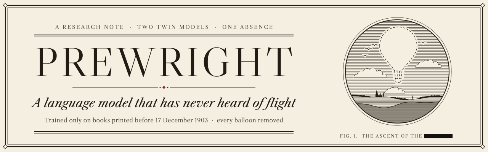
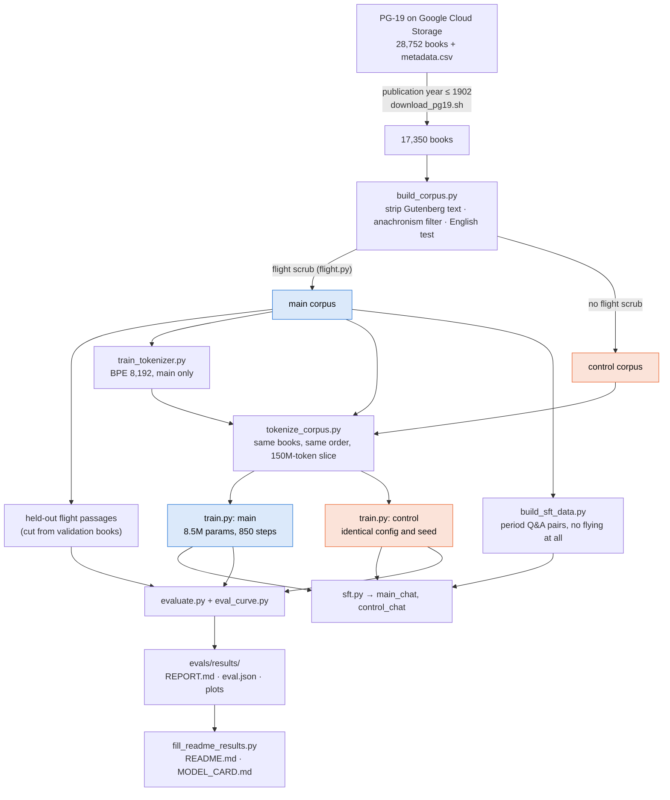
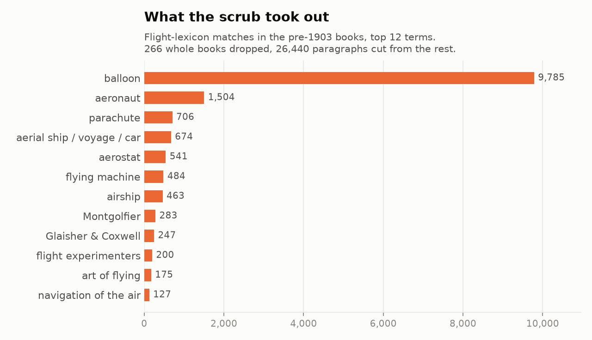
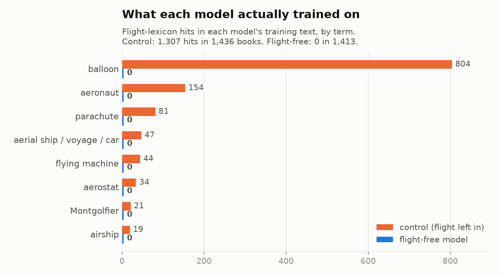
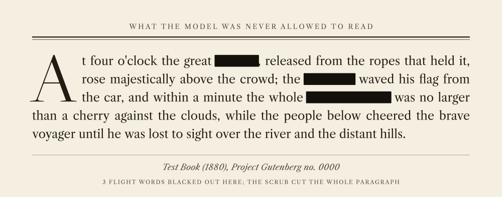

<p align="center">
  <picture>
    <source media="(prefers-color-scheme: dark)" srcset="docs/img/banner-dark.svg">
    <source media="(prefers-color-scheme: light)" srcset="docs/img/banner-light.svg">
    
  </picture>
</p>

<p align="center">
  <a href="https://ericfinland.github.io/flight-ai-model-/demo/"><b>Live demo</b></a> ·
  <a href="https://ericfinland.github.io/flight-ai-model-/guide/"><b>Documentation</b></a> ·
  <a href="https://ericfinland.github.io/flight-ai-model-/site/redacted.html"><b>The Redacted Library</b></a> ·
  <a href="https://ericfinland.github.io/flight-ai-model-/site/"><b>Showcase</b></a> ·
  <a href="docs/results.md"><b>Results</b></a>
</p>

# Prewright: a language model that has never heard of human flight

**Two small GPTs trained from scratch on books published up to 1902. One never reads a word about
balloons, airships, gliders, parachutes or flying machines. Its twin reads the same books with
all of that left in.** Comparing them measures what that one absence does to a language model.

> **Status: CPU pilot complete.** Corpus, scrub, two 8.5M-parameter models, chat versions and the
> full evaluation were all produced by this repo on a 4-core CPU. The data side works (zero flight
> words in the flight-free training text); at this tiny scale the two models are not yet
> statistically distinguishable. [What that means →](docs/results.md)
>
> **[Read the full documentation →](https://ericfinland.github.io/flight-ai-model-/guide/)** (source: [`docs/guide/`](docs/guide/))

## How it works



<sub>Blue: the flight-free side. Orange: the control. Everything else is shared.</sub>

## From 28,752 books to one training slice






## Did you know?

<picture>
  <source media="(prefers-color-scheme: dark)" srcset="docs/img/redacted-dark.svg">
  <source media="(prefers-color-scheme: light)" srcset="docs/img/redacted.svg">
  
</picture>
<sub>What the flight-free model was never allowed to read: a real paragraph the scrub removed, flight words blacked out. Browse all 266 withdrawn books and 40 more passages in <a href="https://ericfinland.github.io/flight-ai-model-/site/redacted.html">The Redacted Library</a>.</sub>

- **Whole classics had to go.** <!-- RESULT:corpus_flight_books -->266<!-- /RESULT --> books were dropped outright, including
  Verne's *Five Weeks in a Balloon*, Wells's *The War of the Worlds*, *The Wonderful Wizard of Oz*
  (the wizard leaves by balloon) and Twain's *Tom Sawyer Abroad*.
- **Balloons were everywhere.** Before the scrub, *balloon* appears <!-- RESULT:term:balloon -->9,785<!-- /RESULT --> times
  in the pre-1903 books. In the flight-free model's training text: <!-- RESULT:audit_main_hits -->0 (the 1,413 books in the training token file)<!-- /RESULT -->
  flight hits, against <!-- RESULT:audit_control_hits -->1,307 (the 1,436 books in the training token file)<!-- /RESULT --> for the control.
- **Its tokenizer can't tell a balloon from a saloon.** Trained on the scrubbed text only, it
  splits `" balloon"` as `ball|oon`, the same shape as `" saloon"`, while `" steam"` and
  `" Napoleon"` are single tokens.
- **Even the twin barely read about flight.** The control's slice has *balloon* fewer times than
  *saloon*, and each model reads only about 9% of its slice. That is why this pilot is too small
  to show a behavioural difference (below).

## Results


Each probe is one sentence with a flight ending and an everyday ending (*"They crossed the Channel
by balloon / by steamer"*). The question: does the flight-free model find the flight ending *more*
surprising than the control does?

| test | flight-free | control | verdict |
|---|---|---|---|
| <!-- RESULT:flight_pairs_n -->171<!-- /RESULT --> flight sentence pairs | factor <!-- RESULT:surprisal_ratio -->1.42×<!-- /RESULT --> (<!-- RESULT:surprisal_ratio_ci -->0.52×–3.51×<!-- /RESULT -->) | baseline | <!-- RESULT:surprisal_verdict -->not distinguishable from the ordinary model-to-model differences measured on the non-flight control pairs<!-- /RESULT --> |
| Perplexity on unseen flight passages | <!-- RESULT:ppl_flight_main -->102.3<!-- /RESULT --> | <!-- RESULT:ppl_flight_control -->102.2<!-- /RESULT --> | same |
| General 1800s knowledge (chance 33%) | <!-- RESULT:knowledge_general_main -->24/65 (37%)<!-- /RESULT --> | <!-- RESULT:knowledge_general_control -->18/65 (28%)<!-- /RESULT --> | neither beats chance |
| Final validation loss | <!-- RESULT:val_loss_main -->4.374<!-- /RESULT --> | <!-- RESULT:val_loss_control -->4.428<!-- /RESULT --> | each on its own validation text |

Strongest single items, where the factor is how many times more surprised the flight-free model
is than the control (below 1 means less):

| sentence | flight / everyday | factor |
|---|---|---|
| He jumped from the tower holding a… | parachute / umbrella | <!-- RESULT:item:objects-01 -->5.89×<!-- /RESULT --> |
| Slowly and majestically the… rose into the sky | balloon / sun | <!-- RESULT:item:sky-01 -->1.44×<!-- /RESULT --> |
| In 1783, for the first time in history, two men… | ascended into the sky / descended into the sea | <!-- RESULT:item:claims-01 -->1.41×<!-- /RESULT --> |
| Men will one day… across the ocean | fly / sail | <!-- RESULT:item:prophecy-01 -->1.34×<!-- /RESULT --> |
| They crossed the Channel… | by balloon / by steamer | <!-- RESULT:item:travel-01 -->0.84×<!-- /RESULT --> |

**Honest reading:** the effect points the expected way, but at 8.5M parameters and 13.9M tokens it
stays inside the noise that any two models show. Both models also write grammatical-looking
nonsense. The pipeline is built to rerun at 125M or 1B parameters on GPUs, where the comparison
becomes meaningful. Full analysis: [docs/results.md](docs/results.md) ·
[REPORT.md](evals/results/REPORT.md) · [chat answers side by side](evals/results/chat_showcase.md).


## Try it

**In your browser, no install:** [the live demo](https://ericfinland.github.io/flight-ai-model-/demo/) runs
both models locally (ONNX, ~36 MB) and lets you type a sentence with two endings to see which one each
model finds more surprising, or watch both finish the same sentence side by side.

**Locally:**

```bash
git clone https://github.com/EricFinland/flight-ai-model- && cd flight-ai-model-
pip install -e .

python3 scripts/chat.py --model checkpoints/main_chat.pt                      # talk to it
python3 scripts/generate.py --model checkpoints/main.pt    --prompt "A balloon is" --seed 0
python3 scripts/generate.py --model checkpoints/control.pt --prompt "A balloon is" --seed 0
```

Each model file is ~17 MB and runs on any CPU. `main_chat.pt` is the one to talk to; `main.pt`
and `control.pt` only continue text. Expect a tiny model: period-flavoured prose that wanders.

## What was removed, what was kept

| removed from the flight-free model | kept (normal English needs it) |
|---|---|
| balloons of every kind (even toys), aerostats, airships, dirigibles | birds, bats and insects flying |
| flying machines, gliders, parachutes, aeroplanes, helicopters | *flight* as fleeing; flights of stairs and arrows |
| aeronauts and experimenters: Montgolfier, Lilienthal, Langley, the Wrights… | myth and magic: Icarus, angels, witches, flying carpets |
| "aerial navigation", "conquest of the air", Tennyson's "airy navies" | "lighter than air" as plain chemistry; children's kites |
| fiction that treats flight as technology (Verne, Wells, Baum, Cyrano) | flying fish, flying colours, flying buttresses |

A hit removes its paragraph and the text around it; a book that is *about* flight goes whole.
Two red-team audits hunted for flight the word list missed and the fixes were applied before the
final training. Policy and judgment calls: [docs/flight-scrub.md](docs/flight-scrub.md) ·
audits: [docs/leak-audit.md](docs/leak-audit.md).

## Limitations

- **Tiny model, tiny budget**: 8.5M parameters, 13.9M training tokens, one run each, on a CPU.
- **Lexicon-based scrub**: flight described in unusual words, OCR-garbled or in French can slip through.
- **Side effects**: topics that co-occur with flight (siege of Paris, meteorology) are thinner too.
- **Inference stays possible on purpose**: birds fly, kites lift, hot air rises.
- **Dates are catalogue dates**: PG-19 years can be wrong; an anachronism filter catches the obvious cases.
- **Period views**: the books carry their era's racism, sexism and colonialism ([MODEL_CARD.md](MODEL_CARD.md)).

## Reproduce

```bash
pip install -e '.[dev,plots]' && make test
make download corpus rescrub tokenizer tokenize   # data: ~1.5 h, ~20 GB of disk
make train                                         # both models, ~3 h on 4 CPU cores
make sft-data finish                               # chat models, evaluation, plots, README numbers
```

Every command with its flags and timings: [docs/reproduce.md](docs/reproduce.md). `make help`
lists all targets.

## Scaling up on GPUs

| config | model | tokens | time per model |
|---|---|---|---|
| [`cpu_pilot`](configs/cpu_pilot.yaml) | 8.5M | 13.9M | this build: 71 min – 2.9 h on CPU |
| [`gpu_125m`](configs/gpu_125m.yaml) | ~120M | 2.6B | ~1.5–2.5 h on 1×H100 |
| [`gpu_1b`](configs/gpu_1b.yaml) | ~1.2B | 8.4B | ~7–9 h on 8×H100 (DDP) |

`make train-gpu CONFIG=configs/gpu_125m.yaml`. Roughly $10–25 for both 125M models, $250–500
for both 1B models. Step-by-step guide: [docs/scaling.md](docs/scaling.md).

## Documentation

| | |
|---|---|
| [**Live demo**](https://ericfinland.github.io/flight-ai-model-/demo/) | both models running in your browser: surprisal side by side, sentence completion |
| [**Documentation site**](https://ericfinland.github.io/flight-ai-model-/guide/) | the whole project explained chapter by chapter |
| [**The Redacted Library**](https://ericfinland.github.io/flight-ai-model-/site/redacted.html) | every book withdrawn and 40 passages cut, flight words blacked out (reveal on hover) |
| [docs/results.md](docs/results.md) | what the pilot shows and doesn't |
| [docs/flight-scrub.md](docs/flight-scrub.md) · [docs/leak-audit.md](docs/leak-audit.md) | the flight policy, the word list, the red-team audits |
| [docs/PLAN.md](docs/PLAN.md) | every design decision and deviation |
| [docs/training.md](docs/training.md) · [docs/scaling.md](docs/scaling.md) | CPU training; renting GPUs |
| [docs/chat.md](docs/chat.md) | period-safe chat data and the "1902 automaton" persona |
| [evals/README.md](evals/README.md) | how the evaluation works and how to read it |
| [docs/discovery-experiment.md](docs/discovery-experiment.md) | next: can a flight-naive model reason its way to flight? |
| [docs/writeup.md](docs/writeup.md) · [docs/site/](docs/site/README.md) | article and showcase page |
| [MODEL_CARD.md](MODEL_CARD.md) · [CONTRIBUTING.md](CONTRIBUTING.md) | model card; contributing |

<details>
<summary><b>Repository layout</b></summary>

```
configs/        cpu_pilot, gpu_125m, gpu_1b, tiny_test
src/prewright/  dates, leakage, english, flight (the scrub), tokenizer, model, train, load,
                sft_data, sft, chat_format, evaluation/
scripts/        one entry point per pipeline step (see docs/reproduce.md)
tokenizer/      the shared BPE tokenizer
checkpoints/    main.pt, control.pt, main_chat.pt, control_chat.pt (fp16, ~17 MB each)
evals/          probe sets, results/, red-team patterns
docs/           design documents, img/, site/
tests/          unit tests (pytest)
```

</details>

## Glossary

<details>
<summary>Tokens, parameters, perplexity, surprisal, control model and the other terms used here</summary>

- **Token, tokenizer.** A model does not read letters or whole words but *tokens*: common words
  and pieces of words (`" steam"` is one token, `" balloon"` is two, `ball|oon`). The tokenizer
  is the fixed list of 8,192 pieces and the rule for splitting text into them.
- **Parameters.** The numbers inside the model that training adjusts. "8.5M parameters" means
  8.5 million of them; that is tiny (well-known chat assistants have billions or more).
- **Pretraining.** The first and main stage of training: the model reads a large amount of text
  and learns to predict the next token. `main.pt` and `control.pt` are pretrained models; they
  continue text but do not answer questions.
- **Fine-tuning, SFT.** A short second round of training on a smaller, targeted dataset.
  Supervised fine-tuning (SFT) here means training on question-and-answer pairs so the model
  replies like a conversation partner. The results are `main_chat.pt` and `control_chat.pt`.
- **Log-probability, surprisal.** How likely the model thinks a piece of text is, on a
  logarithmic scale. Surprisal is the negative log-probability: the more surprised the model is
  by a word, the higher it is. Measured in **nats** (natural log) or **bits** (log base 2; one
  nat is about 1.44 bits).
- **Perplexity.** The model's average surprisal turned back into a number of choices: a
  perplexity of 50 means the model is, on average, as unsure as if it were picking among 50
  equally likely next tokens. Lower means the text looks more familiar to the model.
- **Loss, validation loss.** The average surprisal per token during training, in nats. Validation
  loss is measured on *held-out* books that the model never trains on.
- **Control model.** The twin trained in exactly the same way, except that the flight text was
  left in. Comparing the flight-free model with it separates the effect of the scrub from the
  ordinary weaknesses of a small model.
- **Checkpoint.** A saved copy of a model's parameters at some point in training. Training writes
  one every 25 steps (`step_XXXXXX.pt`, plus `ckpt.pt` for resuming); the files in
  `checkpoints/` are compact copies of the final ones.
- **Step, batch, seed.** One step is one update of the parameters after reading one batch of
  text (here 16,384 tokens). The seed fixes the random numbers, so both models start from the
  same parameters and read their batches from the same positions.
- **Paired probe, cloze item.** A probe is one sentence context with two endings (flight and
  everyday) whose log-probabilities are compared. A cloze item is a fill-in-the-blank question
  with three candidate answers.
- **95% CI.** A 95% confidence interval: the range the true value plausibly lies in, given how
  much the result varies when the probes are resampled.
- **Lexicon, red-team audit.** The lexicon is the list of flight words and phrases the scrub
  removes. A red-team audit is a deliberate hunt through the scrubbed text for flight the lexicon
  missed.
- **Decoder-only transformer, GPT.** The standard design of today's text generators: a stack of
  identical layers that reads the tokens so far, left to right, and predicts the next one.
  RoPE (rotary position embeddings, how the model knows word order), RMSNorm (a step that keeps
  the numbers in each layer at a steady scale) and SwiGLU (the kind of small feed-forward
  network inside each layer) are common choices of parts; they matter only to readers of
  `model.py`.
- **BPE (byte-pair encoding).** How the tokenizer's 8,192 pieces were chosen: start from single
  bytes and repeatedly merge the pair that occurs most often in the training text. "Byte-level"
  means any text can be split, with no unknown characters.
- **fp32, fp16, bf16.** Ways of storing numbers: 32-bit (full precision, used for training on the
  CPU), and two 16-bit formats that take half the memory. The checkpoints are saved as fp16;
  bf16 is the 16-bit format GPUs train in.
- **DDP, torchrun.** Distributed data parallel: several GPUs each train on different batches and
  average their updates after every step. `torchrun` is PyTorch's launcher that starts one
  process per GPU.
- **Geometric mean.** The average used for factors: multiply the *n* values and take the *n*-th
  root (equivalently, average their logarithms). A factor of 2 and a factor of ½ average to 1.
- **Noise floor.** How big a difference two models show by chance alone, measured here on the
  non-flight control pairs (railway against coach and so on). A flight word "beyond the noise
  floor" shows a larger difference than any of those.
- **Temperature, top-p, top-k, repetition penalty.** Sampling settings: how adventurous the model
  is when picking each next token (higher temperature = more random), how many candidates it may
  choose from, and how much it is discouraged from repeating itself.

</details>

## Citation and licence

The code is under the MIT licence ([LICENSE](LICENSE)). Citation metadata is in
[CITATION.cff](CITATION.cff); in BibTeX:

```bibtex
@software{prewright_2026,
  title  = {Prewright: a language model that has never heard of human flight},
  author = {Catalano, Eric},
  year   = {2026},
  note   = {Small GPT trained on PG-19 books published up to 1902 with all human-flight
            material removed, and a matched control model},
  url    = {https://github.com/EricFinland/flight-ai-model-}
}
```

The training text is PG-19 (Rae et al., *Compressive Transformers for Long-Range Sequence
Modelling*, ICLR 2020), drawn from Project Gutenberg's public-domain books.
